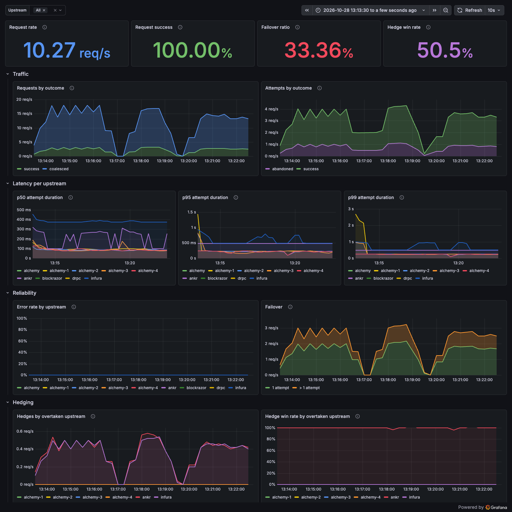

# rpc-plus-plus

An Ethereum JSON-RPC proxy that sits between your app and N upstream providers.

## Why

Apps hardcode a single RPC URL. When that provider rate-limits, slows down, or goes dark, the outage reaches users directly — and the fix is a manual endpoint swap and a redeploy. Every service ends up managing its own list of URLs, and when a request fails there is no single place that says which upstream failed or why.

## Goals

- **Provider outages do not reach users.** If at least one upstream is healthy, the caller should not see the failure.
- **One request is debuggable from logs alone.** Follow a single `request_id` across every upstream attempt and see which provider failed, with what status, and how long it took.

## Status — v0.4

Round-robin or error-rate-ranked selection across upstreams, with retry failover. Two opt-in layers on top: hedging races a second upstream when the first is slow, and dedup coalesces concurrent identical reads into one upstream call.

| | |
|---|---|
| `POST /rpc` | Raw JSON-RPC passthrough. Batches rejected with HTTP 400 |
| `GET /healthz` | Liveness |
| `GET /metrics` | Prometheus exposition: requests by outcome, attempts per request, attempts by outcome, attempt duration, hedges, hedge wins, coalesced requests |

Deliberately not here yet: caching, least-latency routing, auth, multichain. Each release's known gaps are listed in its design doc under [docs/design/](docs/design/) — read them before deploying this anywhere real.

## Run

```sh
cp settings.example.yaml settings.yaml   # then fill in your upstreams
export ALCHEMY_KEY=...                   # or write it to a gitignored .env
cargo run
```

`settings.yaml` is gitignored — a URL written out in full embeds the API key in its path.

```yaml
application:
  port: 8080                  # required
  host: 127.0.0.1             # default 127.0.0.1
  proxy:
    max_attempt: 3            # default 3
    retry_after_in_secs: 1    # default 1
    rpc_timeout_in_secs: 3    # default 3
    hedge:
      enabled: false          # default false
      after_in_millis: 250    # default 250
    dedup:
      enabled: false          # default false
  cors:
    allowed_origins: []       # default [], no CORS

upstreams:                    # required, at least one
  - label: alchemy
    url: https://eth-mainnet.g.alchemy.com/v2/${ALCHEMY_KEY}
    hedge_after_in_millis: 400  # optional, overrides hedge.after_in_millis
  - label: drpc
    url: https://lb.drpc.org/ogrpc?network=ethereum&dkey=${DRPC_KEY}

decider: ROUND_ROBIN          # default ROUND_ROBIN, or PREFER_LEAST_ERRORS
```

Only `application.port` and `upstreams` are required. Upstreams are referred to by `label` everywhere in the logs; the URL is never logged.

`decider` picks the selection strategy. `ROUND_ROBIN` hands out every upstream in turn. `PREFER_LEAST_ERRORS` ranks them by error rate over a rolling window and re-ranks on a 15s timer, logging a `ranking_rebuilt` line each time. An unrecognised value is rejected while the config is read.

`hedge` races the next upstream in the chain once the current one has gone `after_in_millis` without answering, and takes whichever answers first. Writes are never hedged. `after_in_millis` and every per-upstream override must be at least 1. Hedges show up as `rpc_hedges_total` and `rpc_hedge_wins_total`, labelled by the overtaken `upstream` and the one hedged `to`. Design: [v0.3-HEDGING.md](docs/design/v0.3-HEDGING.md).

`dedup` makes concurrent requests with the same `method` and `params` share one upstream call. Each caller still gets its own `id` back. Only idempotent reads are coalesced; writes, notifications and unknown methods always run on their own. It is not a cache: a request arriving after the shared call finished makes a fresh one. Hedging and dedup compose. Every request answered by another's call counts towards `rpc_requests_coalesced_total`, and logs a `request_coalesced` line carrying the `leader_request_id` whose upstream attempts it shared. Design: [v0.4-DEDUP.md](docs/design/v0.4-DEDUP.md).

`cors.allowed_origins` lets browser dapps on those origins call `/rpc`. Empty means no CORS headers at all, which is the behaviour from before CORS existed. `["*"]` allows any origin, and `*` must be the only entry. Every origin has to be written exactly as browsers send it in `Origin`: lowercase `scheme://host[:port]`, with no path, no trailing slash and no default port. Any other spelling could never match, so it fails startup. Only `POST` with a `Content-Type` header is allowed, and browsers may cache the preflight for an hour. CORS only decides which pages can read the responses. It is not access control, because curl and backends ignore it.

The pre-rename spellings still load. `rpcs:` and `rpc_url:` are accepted silently as aliases for `upstreams:` and `url:`; a top-level `rpc_timeout_in_secs` still wins over the one under `application.proxy` and logs one `config_key_deprecated` warn at startup.

`${VAR}` is expanded from the environment at startup, so keys stay out of the file. An unset or empty variable stops startup with a `startup_failed` line naming the **variable** — never the URL. A bare `$VAR` is literal text; the braces are required. Labels must be unique, and no two upstreams may share a URL: both are startup failures, since a duplicate label merges two providers into one identity and a duplicate URL turns failover into the same provider twice.

Set `RPC_CONFIG_PATH` to read the config from somewhere other than `./settings.yaml`.

`application.host` stays on loopback unless you widen it deliberately — inside a container it has to be `0.0.0.0`. There is no auth yet, so a reachable proxy is an open relay spending your upstream API keys.

## Dashboard

```sh
docker compose up -d --build   # proxy on :8080, Prometheus on :9090, Grafana on :3000
scripts/load.sh -u http://127.0.0.1:8080
```

Grafana opens on the provisioned **rpc-plus-plus** dashboard without a login (anonymous Viewer; `admin`/`admin` to edit). The Prometheus datasource and the dashboard are files under [docker/grafana/](docker/grafana/), so they come back on every `docker compose up`.



| Panel | From |
|---|---|
| Request rate, requests by outcome | `rpc_requests_total{outcome}` + `rpc_requests_coalesced_total` |
| Attempts by outcome | `rpc_attempts_total{outcome,upstream}` |
| p50 / p95 / p99 per upstream | `rpc_attempt_duration_seconds` |
| Error rate by upstream | failed answers over all answers in `rpc_attempts_total`; abandoned calls left out |
| Failover | `rpc_request_attempts`: requests that took more than one attempt |
| Hedges, hedge win rate | `rpc_hedges_total`, `rpc_hedge_wins_total` by overtaken `upstream` |

`rpc_requests_total` counts each request that ran its own upstream chain, once, however it ended; a coalesced follower shows up in `rpc_requests_coalesced_total` instead, and a rejected batch in neither. `rpc_request_attempts` is how many upstream calls that chain made. With hedging on, a hedge is an attempt too, so "more than one attempt" means failover *or* a hedge.

## Layout

```
src/
  main.rs        init, load, build, run, and the signal watcher
  app.rs         composition root — Application, build_decider, build
  config.rs      settings.yaml -> Settings: env expansion, validation
  jsonrpc.rs     the wire format: request shape, write detection, dedup key, re-addressing
  telemetry.rs   tracing subscriber
  http/          the axum surface — build_router plus one handler per route
  proxy/         Pipeline: the retry loop; attempt.rs one call, hedge.rs the race,
                 reply.rs the shared answer, singleflight/ the in-flight dedup map
  upstream/      Upstream, UpstreamId, build_all; call.rs holds the per-call vocabulary
  decider/       the Decider trait, round_robin.rs, prefer_least_errors/
  observer/      the Observer seam and MetricsObserver; snapshot.rs values, prometheus.rs exposition
```

### Renamed in the v0.2.1 re-layer

| Old | New |
|---|---|
| `settings.rs`, `RpcSettings { label, rpc_url }` | `config.rs`, `UpstreamSettings { label, url }` |
| yaml `rpcs:` / `rpc_url:` / top-level `rpc_timeout_in_secs` | `upstreams:` / `url:` / `application.proxy.rpc_timeout_in_secs` |
| `start_up.rs`, `build_upstreams` | `app.rs`, `upstream::build_all` |
| `route/`, `rpc_proxy` / `get_health` | `http/`, `post_rpc` / `get_healthz` |
| `ProxyState`, `check_if_batch` | `proxy::Pipeline`, `proxy::jsonrpc::is_batch` |
| `StatsSnapshot`, `DiffStats` | `observer::snapshot::Snapshot`, `observer::snapshot::Diff` |
| `MetricsCollector` (in `route/metrics.rs`) | `observer::prometheus::Collector` |
| `Cached`, `PreferLeastErrorBuildError` and the other three `*BuildError` | `Ranking`, one `BuildError` per module |
| `UpstreamBuilder`, `ProxyStateBuilder`, `PreferLeastErrors::spawn(..6 args)` | `bon` builders on `Upstream`, `Pipeline`, `PreferLeastErrors`, `Application` |

Old config files still load — see the deprecation note above. `NoopObserver` and `CallError::as_str` were unused and are gone.

## Docs

- [docs/spec.md](docs/spec.md) — product requirements, full feature set
- [docs/roadmap.md](docs/roadmap.md) — what lands next
- [docs/erpc-comparison.md](docs/erpc-comparison.md) — feature comparison with eRPC
- [docs/erpc-gap-priorities.md](docs/erpc-gap-priorities.md) — eRPC gaps ranked by value for effort
- [docs/design/v0.1.md](docs/design/v0.1.md) — v0.1 design, log schema, known bugs
- [docs/design/v0.2.1-DECIDER.md](docs/design/v0.2.1-DECIDER.md) — the windowed error-rate decider
- [docs/design/v0.3-HEDGING.md](docs/design/v0.3-HEDGING.md) — hedged requests
- [docs/design/v0.4-DEDUP.md](docs/design/v0.4-DEDUP.md) — in-flight dedup
- [docs/commit-style.md](docs/commit-style.md) — commit convention
