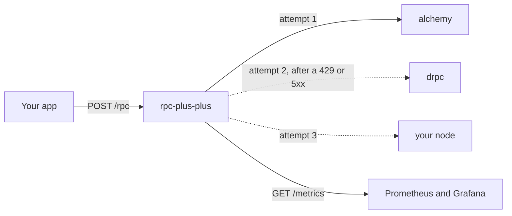

# rpc-plus-plus

```
██████╗  ██████╗   ██████╗
██╔══██╗ ██╔══██╗ ██╔════╝     ██╗       ██╗
██████╔╝ ██████╔╝ ██║       ████████╗ ████████╗
██╔══██╗ ██╔═══╝  ██║       ╚══██╔══╝ ╚══██╔══╝
██║  ██║ ██║      ╚██████╗     ╚═╝       ╚═╝
╚═╝  ╚═╝ ╚═╝       ╚═════╝
  one RPC URL in front of every Ethereum provider you use
```

[](https://github.com/Jds-23/rpc-plus-plus/actions/workflows/ci.yml)

rpc-plus-plus is an Ethereum JSON-RPC proxy written in Rust. Your app sends its calls to the proxy. The proxy picks an upstream for each call, such as Alchemy, dRPC, or your own node, and moves to the next upstream when one fails.



## Why a proxy in front of your providers

Most apps hardcode one RPC URL. That one provider then decides your uptime. When it returns `429`, takes two seconds to answer, or stops answering, your users see the failure. The fix is a manual URL swap and a redeploy, made while the outage is still happening.

Adding a second URL to the app does not solve the problem. Every service then carries its own list of URLs and its own retry code. When a call fails, no single place records which provider failed, with what error, or how long it took.

rpc-plus-plus moves the list of providers and the retry rules out of the app and into one service. The app keeps one URL. The proxy picks a provider for each call, and it moves to the next provider when a call fails. The proxy also logs and counts every call that it makes. A provider outage becomes a line on a dashboard instead of an incident.

## What you can do with it

With rpc-plus-plus in front of your providers, you can do the following:

- **Survive a provider outage.** If an upstream times out, can't be reached, or returns HTTP `429` or `5xx`, the proxy retries the call on the next upstream, up to `max_attempt` attempts. A JSON-RPC error that the upstream marks as not retryable, such as a reverted call, goes straight back to the caller.
- **Route to the fastest provider.** The `LEAST_LATENCY` decider ranks upstreams by their recent response time and sends new calls to the fastest one. `PREFER_LEAST_ERRORS` ranks them by error rate instead. `ROUND_ROBIN` gives each upstream a turn.
- **Cut tail latency.** With hedging on, the proxy sends a read to a second upstream when the first one is slow to answer. The first answer wins. The proxy never hedges writes.
- **Send fewer duplicate calls.** With dedup on, concurrent calls that have the same `method` and `params` share one upstream call. Each caller still gets a response with its own `id`.
- **Debug one call from the logs.** Every log line carries a `request_id`. Follow it to see which upstream the proxy tried, what each one returned, and how long each attempt took. Logs name an upstream by its `label` and never print its URL, so API keys stay out of the logs.
- **Watch the whole fleet on one dashboard.** `GET /metrics` serves Prometheus metrics, and `docker compose` starts a Grafana dashboard that already shows them.
- **Serve browser dapps.** CORS settings let pages on the origins that you list call `/rpc`.

## How a call moves through rpc-plus-plus

```
            your app
               │  POST /rpc
               ▼
 ┌──────────────────────────────────────────────────────────────┐
 │ http/        CORS check, then hand the body to the Pipeline  │
 ├──────────────────────────────────────────────────────────────┤
 │ proxy/       new request_id                                  │
 │              batch or malformed body ──────────▶ HTTP 400    │
 ├──────────────────────────────────────────────────────────────┤
 │ dedup        same read method and params in flight?          │
 │ (opt-in)       yes ──▶ wait for that call, reply with own id │
 │                no  ──▶ continue                              │
 ├──────────────────────────────────────────────────────────────┤
 │ decider/     order the upstreams, cut to max_attempt         │
 │              ROUND_ROBIN, PREFER_LEAST_ERRORS, LEAST_LATENCY │
 ├──────────────────────────────────────────────────────────────┤
 │ dispatch     hedge off       ──▶ walk the chain, fail over   │
 │              hedge on, read  ──▶ race the next upstream      │
 │              hedge on, write ──▶ one upstream, no retry      │
 └──────────────┬──────────────────┬──────────────────┬─────────┘
                ▼                  ▼                  ▼
           ┌─────────┐        ┌─────────┐        ┌───────────┐
           │ alchemy │        │  drpc   │        │ your node │
           └─────────┘        └─────────┘        └───────────┘

 observer/    every attempt and request ──▶ GET /metrics
              every step               ──▶ logs tagged with request_id
```

## See a failover in the logs

Here is one `eth_blockNumber` call during an Alchemy rate limit, as JSON logs with the `timestamp` and `target` fields removed. All four lines carry the same `request_id`.

```json
{"level":"INFO","event":"attempt_started","attempt":1,"upstream":"alchemy","hedge":false,"span":{"request_id":"6f0c2a9e-4b1d-4f7a-9c3e-2d8b5a1e7f40","name":"proxy"}}
{"level":"WARN","event":"attempt_failed","attempt":1,"upstream":"alchemy","duration_ms":41,"http_status":429,"error":"upstream returned error status","span":{"request_id":"6f0c2a9e-4b1d-4f7a-9c3e-2d8b5a1e7f40","name":"proxy"}}
{"level":"INFO","event":"attempt_started","attempt":2,"upstream":"drpc","hedge":false,"span":{"request_id":"6f0c2a9e-4b1d-4f7a-9c3e-2d8b5a1e7f40","name":"proxy"}}
{"level":"INFO","event":"attempt_succeeded","attempt":2,"upstream":"drpc","duration_ms":87,"http_status":200,"response_bytes":42,"span":{"request_id":"6f0c2a9e-4b1d-4f7a-9c3e-2d8b5a1e7f40","name":"proxy"}}
```

The app got a normal response from `drpc`. The logs show why Alchemy didn't answer and how long each attempt took. `rpc_failovers_total{upstream="alchemy"}` goes up by one.

## Try it

In this section, you start the proxy against two public Ethereum endpoints and send it a call. You need a Rust toolchain.

1. Create `settings.yaml` with two upstreams:

    ```yaml
    application:
      port: 8080
    upstreams:
      - label: publicnode
        url: https://ethereum-rpc.publicnode.com
      - label: drpc
        url: https://eth.drpc.org
    decider: LEAST_LATENCY
    ```

2. Start the proxy:

    ```sh
    cargo run
    ```

    The last startup line has `event="startup_ready"` and `upstreams=2`. In a terminal, the logs are text. When stdout is not a terminal, the logs are JSON lines.

3. In a second terminal, ask for the latest block number:

    ```sh
    curl -s http://127.0.0.1:8080/rpc \
    	-H 'Content-Type: application/json' \
    	-d '{"jsonrpc":"2.0","id":1,"method":"eth_blockNumber","params":[]}'
    ```

    The response is a normal JSON-RPC response, for example `{"jsonrpc":"2.0","id":1,"result":"0x15f3a2c"}`.

4. Look at the proxy logs. One `attempt_started` line and one `attempt_succeeded` line share the `request_id` of your call, and they name the upstream that answered.

To use your own providers, copy `settings.example.yaml` to `settings.yaml`. Put API keys in environment variables and refer to them as `${ALCHEMY_KEY}` in the URL. `settings.yaml` is gitignored because a URL with a key in it is a secret.

## Know the limits before you deploy

The proxy has no authentication. If the proxy is reachable from outside your network, anyone can send calls that spend your upstream API keys. `application.host` defaults to `127.0.0.1` for this reason. Change it only when something in front of the proxy controls access.

The proxy does not do the following yet:

- It does not cache responses. Dedup shares a call only while it is still in flight.
- It does not accept JSON-RPC batches. A batch gets HTTP `400`.
- It serves one chain per process.

Each design doc under [docs/design/](docs/design/) lists the known gaps of its release.

## Find the details

- [Configuration reference](docs/configuration.md): every setting, its default, and the startup checks.
- [Metrics and dashboard reference](docs/metrics.md): every metric, its labels, and the Grafana panels.
- [Source layout](docs/layout.md): what each module in `src/` does, and the names that changed in v0.2.1.
- [Product spec](docs/spec.md): the full feature set the project aims at.
- [Comparison with eRPC](docs/erpc-comparison.md) and [eRPC gaps ranked by value for effort](docs/erpc-gap-priorities.md).
- Design docs: [v0.1](docs/design/v0.1.md) with the log schema, [error-rate decider](docs/design/v0.2.1-DECIDER.md), [hedging](docs/design/v0.3-HEDGING.md), [dedup](docs/design/v0.4-DEDUP.md), and [least-latency decider](docs/design/v0.5-LATENCY.md).

## Contribute

The checks run through [`just`](https://github.com/casey/just) and [`cargo-nextest`](https://nexte.st). CI runs the same recipes.

```sh
just ci                  # fmt-check, clippy, tests, and doctests
just test observer       # tests that match a filter
just test-file cors      # one tests/<name>.rs file
just fix                 # cargo fmt and clippy --fix
```

Commit messages follow [docs/commit-style.md](docs/commit-style.md).
