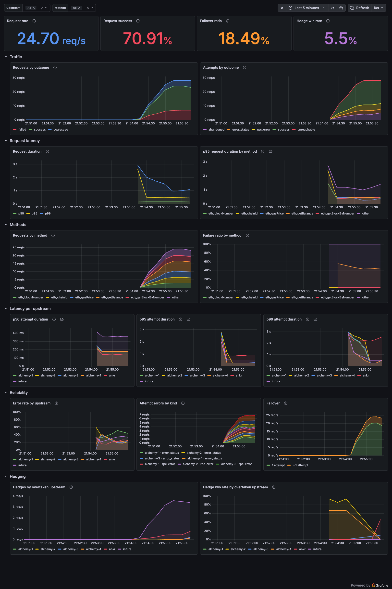

# Metrics and dashboard reference

`GET /metrics` serves Prometheus metrics. `GET /healthz` returns `OK`.

## Metrics

| Metric | Labels | Counts |
|---|---|---|
| `rpc_requests_total` | `method`, `outcome` | Each request that ran its own upstream chain, once, however it ended. |
| `rpc_requests_coalesced_total` | none | Each request that dedup answered with another request's call. |
| `rpc_request_attempts` | `method` | The number of upstream calls that one chain made. With hedging on, a hedge is an attempt. |
| `rpc_request_duration_seconds` | `method` | The time of one chain, from the request to its answer. Failovers and hedges are included. |
| `rpc_attempts_total` | `upstream`, `outcome` | Each upstream call by its result. |
| `rpc_attempt_duration_seconds` | `upstream` | The time of one upstream call. |
| `rpc_failovers_total` | `upstream` | Each time the chain moved past that upstream after a retryable failure. Hedges are not counted. |
| `rpc_hedges_total` | `upstream`, `to` | Each hedge, by the slow `upstream` and the upstream it hedged `to`. |
| `rpc_hedge_wins_total` | `upstream`, `to` | Each hedge that answered first. |

A rejected batch counts in no metric.

The `method` label is one of the known read and send methods, or `other` for any other method. The label set therefore cannot grow with what callers send. A method appears on `/metrics` only after a request for it has run.

More than one attempt in `rpc_request_attempts` means a failover, a hedge, or both. To count failovers alone, use `rpc_failovers_total`.

## Dashboard

Start the proxy, Prometheus, and Grafana, then send load:

```sh
docker compose up -d --build   # proxy on :8080, Prometheus on :9090, Grafana on :3000
scripts/load.sh -u http://127.0.0.1:8080
```

`scripts/load.sh` needs `oha` and `jq`. Run `scripts/load.sh -h` for its options.

Grafana opens on the **rpc-plus-plus** dashboard with no login, as an anonymous viewer. To edit the dashboard, sign in as `admin` with the password `admin`. The Prometheus datasource and the dashboard are files under [docker/grafana/](../docker/grafana/), so `docker compose up` restores them every time.



| Panel | Source |
|---|---|
| Request rate, requests by outcome | `rpc_requests_total{method,outcome}` and `rpc_requests_coalesced_total` |
| Attempts by outcome | `rpc_attempts_total{outcome,upstream}` |
| Request duration p50, p95, and p99, p95 by method | `rpc_request_duration_seconds` |
| Requests by method, failure ratio by method | `rpc_requests_total{method,outcome}` |
| p50, p95, and p99 per upstream | `rpc_attempt_duration_seconds` |
| Error rate by upstream | Failed answers over all answers in `rpc_attempts_total`. Abandoned calls are left out. |
| Attempt errors by kind | `rpc_attempts_total` by `upstream` and failed `outcome` |
| Failover ratio, failover | `rpc_failovers_total{upstream}` |
| Hedges, hedge win rate | `rpc_hedges_total` and `rpc_hedge_wins_total` by `upstream` |
